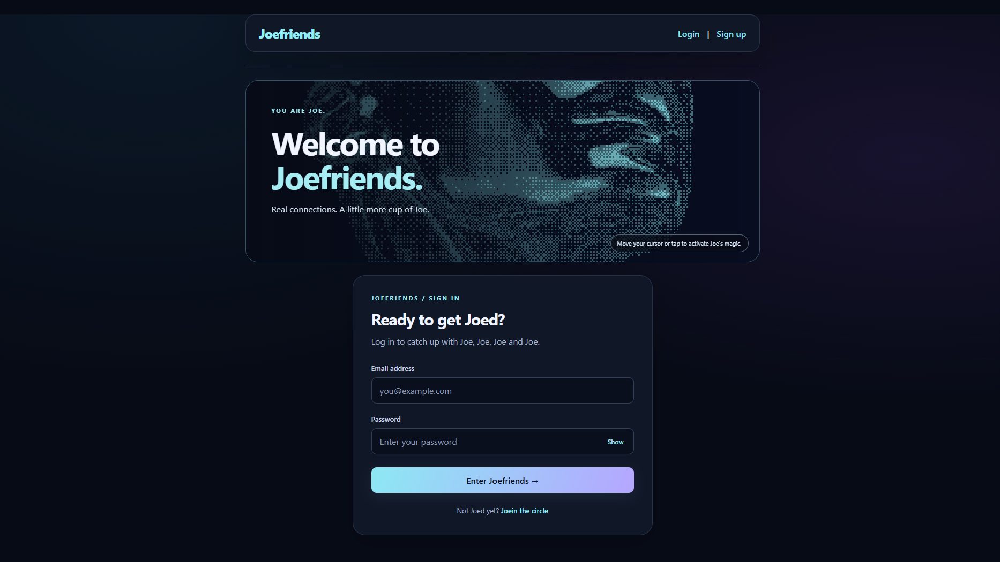
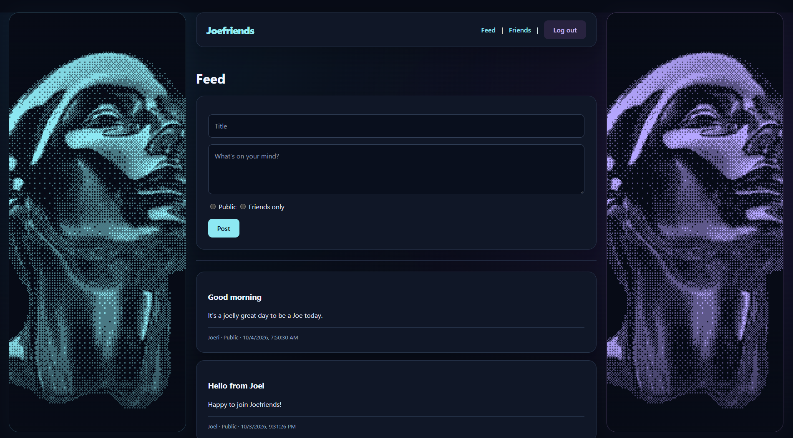

# Joefriends Frontend

Joefriends is a social media application. Users can create accounts, log in, publish posts, and connect through friend requests.

This React frontend connects to an Express API backed by Supabase Authentication and PostgreSQL.

## Screenshot




## Project Links

- Backend API: https://joefriends-backend-sigma-mission-9.vercel.app
- Backend repository: https://github.com/joe-ship-it-nice/Joefriends-backend-sigma-mission-9

## Features

- Sign up with a username, email, and password.
- Log in using Supabase authentication through the backend.
- Create public or friends-only posts.
- View public posts, your own posts, and accepted friends’ friends-only posts.
- Browse other users and send friend requests.
- Accept incoming friend requests.
- Display pending requests and accepted friendships.
- Protect frontend pages using authentication context.
- Log out and remove the locally stored token.
- Display loading states and API error messages.
- Futuristic styling with interactive Dither Veil effects.

## Technologies

- React
- Vite
- React Router
- CSS
- OGL and React Bits Dither Veil
- Fetch API
- Express backend
- Supabase Authentication and PostgreSQL

## Frontend Routes

| Route | Page | Access |
|---|---|---|
| `/signup` | Create an account | Guests |
| `/login` | Log in | Guests |
| `/feed` | Read and create posts | Logged-in users |
| `/friends` | Manage friend requests and friendships | Logged-in users |

## Authentication and Authorization

After login, the frontend stores the returned access token in
`localStorage`. Requests made through `apiFetch` include it in the header:

```http
Authorization: Bearer YOUR_ACCESS_TOKEN
```

## Test Login Account

Use this demo account to try Joefriends:

- **Email:** joe@joe.com
- **Password:** JOEJOEJOE

Open the live frontend, go to **Login**, and enter these details.


## Author

Lim Joe Onn — A Joefriend.